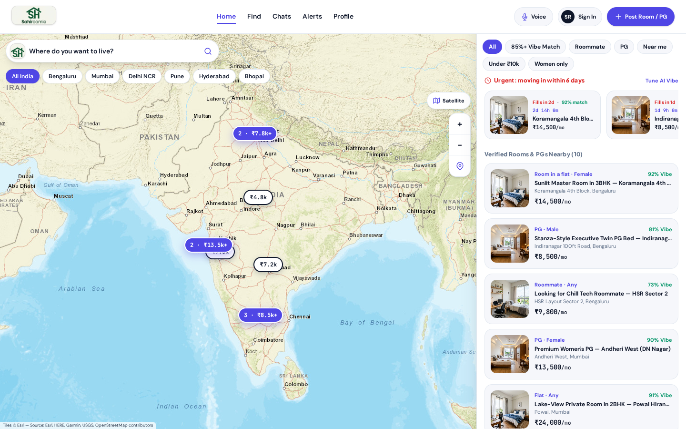
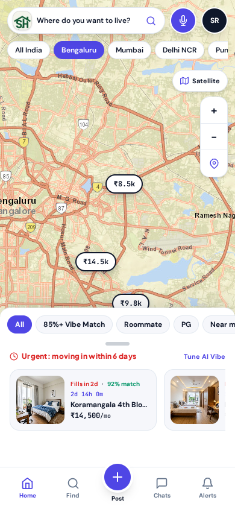

# Sahiroomie

[](https://react.dev/)
[](https://www.typescriptlang.org/)
[](https://vite.dev/)
[](https://tailwindcss.com/)
[](https://leafletjs.com/)
[](https://firebase.google.com/)
[](https://expressjs.com/)
[](#checks--unit-tests)
[](LICENSE)

<!-- Once pushed to GitHub, uncomment and replace <owner>/<repo> to show a live GitHub Actions CI badge:
[](https://github.com/<owner>/<repo>/actions/workflows/ci.yml)
-->

**Verified Roommate, PG & Flat Finder for India** — built with React, TypeScript, Vite, Express, Tailwind CSS, Leaflet, and Firebase (Firestore & Auth).


## Preview Gallery

| All India Live City Clusters | Satellite Map View | Mobile Experience |
| :---: | :---: | :---: |
|  |  |  |

<div align="center">

<!-- Replace this SVG/URL with your custom logo in public/logo.svg or public/logo.png -->


# Sahiroomie 🏠✨

**Verified Roommate, PG & Flat Finder for India — Zero Brokerage, 100% Vibe-Matched.**

[](https://sahiroomie.vercel.app)
[](https://www.typescriptlang.org/)
[](https://react.dev/)
[](https://firebase.google.com/)
[](https://tailwindcss.com/)
[](LICENSE)

[Explore Live App](https://sahiroomie.vercel.app) • [Report Bug](https://github.com/code-with-rv/Sahiroomie/issues) • [Request Feature](https://github.com/code-with-rv/Sahiroomie/issues)

</div>

---

## 📖 Overview

**Sahiroomie** reimagines shared living across India by eliminating broker fees and guesswork. Combining **AI-powered Gen-Z Vibe Compatibility**, **1 km privacy-first map masking**, and a **real-time AI Voice Concierge**, Sahiroomie helps students and working professionals find verified PGs, rooms in shared flats, and compatible roommates effortlessly.

---

## ✨ Key Features

<table>
  <tr>
    <td width="50%">
      <h3>🧠 Gen-Z Vibe Compatibility & AI Coach</h3>
      <p>Weighted compatibility scoring across <strong>sleep schedule, cleanliness, social battery, WFH noise, and house habits</strong>. Customize your profile in the interactive <em>Vibe Studio</em> and get personalized coaching via <code>/api/vibe-analysis</code>.</p>
    </td>
    <td width="50%">
      <h3>🎙️ Real-Time AI Voice Concierge</h3>
      <p>Hands-free conversational assistant for discovering rooms, comparing neighborhoods, and navigating listings with live audio streaming and instant transcripts.</p>
    </td>
  </tr>
  <tr>
    <td width="50%">
      <h3>🗺️ Interactive Street & Satellite Map</h3>
      <p>Zoom-aware Leaflet map powered by Esri World Street & Imagery tiles across <strong>Bengaluru, Mumbai, Delhi NCR, Pune, Hyderabad, Bhopal</strong>, and All India—complete with city clustering, geolocation, dark-mode tiles, and Google Maps handoff.</p>
    </td>
    <td width="50%">
      <h3>🛡️ 1 km Privacy Halo & Trust Controls</h3>
      <p>Exact flat and PG addresses remain masked inside a <strong>1 km dashed privacy halo</strong> until a visit is scheduled. Built-in scam-keyword screening and <strong>Aadhaar (Verhoeff checksum) / PAN</strong> verification utilities keep listings authentic.</p>
    </td>
  </tr>
  <tr>
    <td width="50%">
      <h3>⚡ Smart Discovery & Urgent Stays</h3>
      <p>One-tap quick filters (<code>85%+ Vibe Match</code>, <code>Under ₹10k</code>, <code>Women only</code>, <code>Near me</code>), deep preference modals, and a live <strong>Urgent: moving in within 6 days</strong> countdown carousel.</p>
    </td>
    <td width="50%">
      <h3>🌐 Multilingual & Adaptive UI</h3>
      <p>Full localization in <strong>English</strong>, <strong>हिन्दी (Hindi)</strong>, <strong>ಕನ್ನಡ (Kannada)</strong>, and <strong>मराठी (Marathi)</strong> with seamless Light and Dark themes.</p>
    </td>
  </tr>
</table>

---

## 📸 Product Tour

<details open>
<summary><b>Click to toggle Preview Gallery</b></summary>
<br />

| All-India Live City Clusters | Satellite Map View | Mobile Experience |
| :---: | :---: | :---: |
|  |  |  |

*(Tip: Update the image paths above to match your screenshots inside `/docs` or `/public`)*
</details>

---

## 🛠️ Tech Stack

| Layer | Technologies |
| :--- | :--- |
| **Frontend** | React, TypeScript, Vite, Tailwind CSS |
| **Maps & Geo** | Leaflet, Esri World Street & Imagery Tiles, Browser Geolocation |
| **Backend & API** | Node.js, Express (`server.ts`, `/api/*`), Schema.org JSON-LD SEO |
| **Database & Auth** | Firebase Authentication (Google & Email), Cloud Firestore (Real-Time Sync) |
| **Testing & Quality** | `tsx --test` native test runner, ESLint |

---

## 🚀 Getting Started

### Prerequisites
- **Node.js** `>= 18.x` (or **Bun**)
- A **Firebase** project with Firestore and Authentication enabled

### 1. Clone the Repository
```bash
git clone [https://github.com/code-with-rv/Sahiroomie.git](https://github.com/code-with-rv/Sahiroomie.git)
cd Sahiroomie
