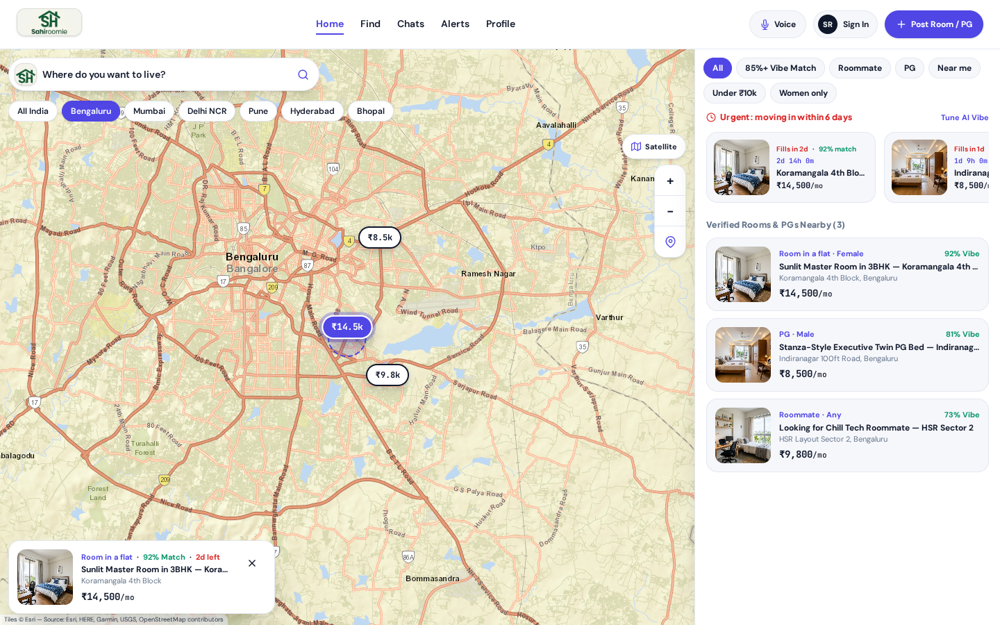
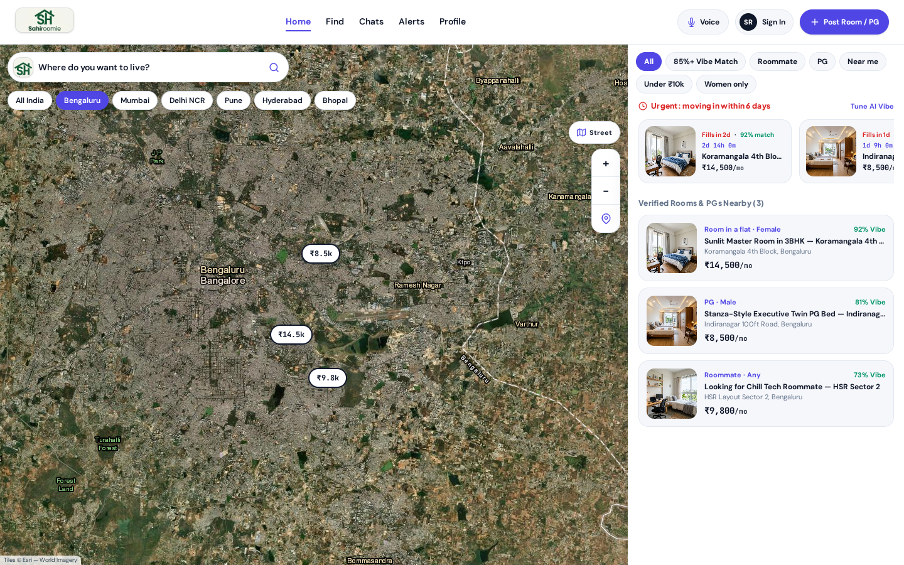
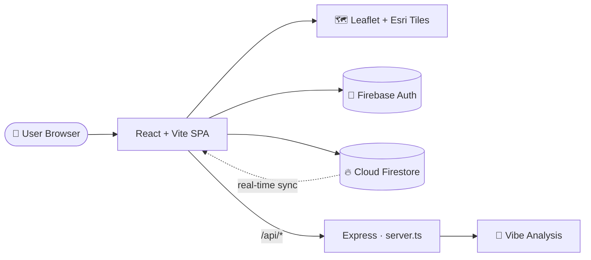

# Sahiroomie 🏠✨

### Verified Roommate, PG & Flat Finder for India
**Zero brokerage · AI vibe matching · 1 km privacy-first maps**

[](https://sahiroomie.vercel.app)
[](LICENSE)
[](#-testing)

[](https://react.dev/)
[](https://www.typescriptlang.org/)
[](https://vite.dev/)
[](https://tailwindcss.com/)
[](https://firebase.google.com/)
[](https://expressjs.com/)

[**🚀 Try the app**](https://sahiroomie.vercel.app) · [**🐞 Report a bug**](https://github.com/code-with-rv/Sahiroomie/issues) · [**💡 Request a feature**](https://github.com/code-with-rv/Sahiroomie/issues)

</div>

---

## 🧭 Explore this README

<table>
<tr>
<td>🎯 <a href="#-overview">Overview</a></td>
<td>✨ <a href="#-features">Features</a></td>
<td>🖼️ <a href="#%EF%B8%8F-gallery">Gallery</a></td>
</tr>
<tr>
<td>🏗️ <a href="#%EF%B8%8F-architecture">Architecture</a></td>
<td>🛠️ <a href="#%EF%B8%8F-tech-stack">Tech stack</a></td>
<td>⚡ <a href="#-quick-start">Quick start</a></td>
</tr>
<tr>
<td>🔐 <a href="#-security--privacy">Security</a></td>
<td>🧪 <a href="#-testing">Testing</a></td>
<td>🗺️ <a href="#%EF%B8%8F-roadmap">Roadmap</a></td>
</tr>
</table>

---

## 🎯 Overview

**Sahiroomie** rethinks shared living in India. Students and working professionals can find **verified PGs, rooms in shared flats, and compatible roommates** without paying broker fees or guessing about neighbours.

> **The core idea:** match people on *how they live*, not just *where they live*, and keep exact addresses private until a visit is genuinely scheduled.

<div align="center">

| 💸 Brokerage | 🧠 Matching | 🛡️ Privacy |
|:---:|:---:|:---:|
| **0%** | **Weighted vibe score** | **1 km halo until visit** |

</div>

---

## ✨ Features

Click any card to expand it.

<details>
<summary><b>🧠 Gen-Z Vibe Compatibility & AI Coach</b></summary>

<br>

Compatibility is scored across five weighted dimensions:

- 😴 **Sleep schedule**
- 🧹 **Cleanliness**
- 🎉 **Social battery**
- 💻 **WFH noise**
- 🏡 **House habits**

Customise your profile in the interactive **Vibe Studio** and get personalised coaching from `/api/vibe-analysis`.

</details>

<details>
<summary><b>🎙️ Real-Time AI Voice Concierge</b></summary>

<br>

A hands-free assistant for finding rooms, comparing neighbourhoods, and moving through listings. Live audio streaming and instant transcripts keep the conversation flowing.

</details>

<details>
<summary><b>🗺️ Interactive Street & Satellite Maps</b></summary>

<br>

- Zoom-aware Leaflet map with **Esri World Street & Imagery** tiles
- City clustering across **Bengaluru, Mumbai, Delhi NCR, Pune, Hyderabad, Bhopal** and All India
- Browser geolocation, dark-mode tiles, and a one-tap **Google Maps handoff**

</details>

<details>
<summary><b>🛡️ 1 km Privacy Halo & Trust Controls</b></summary>

<br>

- Exact flat and PG addresses stay hidden inside a **1 km dashed privacy halo**
- The exact location unlocks only once a visit is scheduled
- Built-in **scam-keyword screening**
- **Aadhaar** (Verhoeff checksum) and **PAN** verification utilities

</details>

<details>
<summary><b>⚡ Smart Discovery & Urgent Stays</b></summary>

<br>

- One-tap quick filters: `85%+ Vibe Match` · `Under ₹10k` · `Women only` · `Near me`
- Deep preference modals for fine-grained search
- Live **"Moving in within 6 days"** carousel for urgent listings

</details>

<details>
<summary><b>🌐 Multilingual & Adaptive UI</b></summary>

<br>

Full localisation in **English**, **हिन्दी**, **ಕನ್ನಡ**, and **मराठी**, with light and dark themes and a responsive mobile layout.

</details>

---

## 🖼️ Gallery

<div align="center">

<a href="docs/screenshots/desktop-street-map.png">
  
</a>

</div>

<details open>
<summary><b>📸 Click to switch views</b></summary>

<br>

<table>
<tr>
<th>🇮🇳 All-India Clusters</th>
<th>🛰️ Satellite View</th>
<th>📱 Mobile Home</th>
</tr>
<tr>
<td></td>
<td></td>
<td></td>
</tr>
</table>

</details>

---

## 🏗️ Architecture



---

## 🛠️ Tech Stack

| Layer | Technologies |
|---|---|
| 🎨 **Frontend** | React · TypeScript · Vite · Tailwind CSS |
| 🗺️ **Maps & Geo** | Leaflet · Esri World Street & Imagery · Browser Geolocation |
| ⚙️ **Backend** | Node.js · Express (`server.ts`, `/api/*`) · Schema.org JSON-LD for SEO |
| 🔥 **Data & Auth** | Firebase Auth (Google & Email) · Cloud Firestore (real-time) |
| 🧪 **Quality** | `tsx --test` native runner · ESLint |

---

## ⚡ Quick Start

### ✅ Prerequisites

- **Node.js** `>= 18` *or* **Bun**
- A **Firebase** project with **Firestore** and **Authentication** enabled

### 📦 Setup

<details open>
<summary><b>Step 1 · Clone</b></summary>

```bash
git clone https://github.com/code-with-rv/Sahiroomie.git
cd Sahiroomie
```

</details>

<details>
<summary><b>Step 2 · Install dependencies</b></summary>

```bash
# with Bun (recommended, bun.lock is included)
bun install

# or with npm
npm install
```

</details>

<details>
<summary><b>Step 3 · Configure environment</b></summary>

```bash
cp .env.example .env
cp firebase-applet-config.example.json firebase-applet-config.json
```

Fill in your Firebase web config and any API keys listed in `.env.example`.
Never commit these files. They are already covered by `.gitignore`.

</details>

<details>
<summary><b>Step 4 · Secure your database</b></summary>

Publish the Firestore security rules from `firestore.rules` in your Firebase console (or with the Firebase CLI) before going live. The rules are documented in `security_spec.md`.

</details>

<details>
<summary><b>Step 5 · Run it 🎉</b></summary>

```bash
bun run dev      # or: npm run dev
```

Open **http://localhost:3000** (or the port shown in your terminal).

</details>

> 💡 Exact script names live in `package.json`. Check there if a command above differs.

---

## 🔐 Security & Privacy

<details>
<summary><b>How listings and personal data are protected</b></summary>

<br>

| Concern | How Sahiroomie handles it |
|---|---|
| 📍 **Exact address** | Hidden behind a 1 km halo until a visit is scheduled |
| 🪪 **Identity** | Aadhaar and PAN checks run client-side, with checksum validation |
| 🚫 **Scams** | Keyword screening on listing text |
| 🔒 **Data access** | Enforced through Firestore security rules |
| 🔑 **Secrets** | Kept in `.env` and `firebase-applet-config.json`, never in source |

Please report vulnerabilities privately through a GitHub issue marked *security*, or contact the maintainers directly. Do not post exploit details publicly.

</details>

---

## 🧪 Testing

```bash
bun test          # or: npx tsx --test
```

The suite runs on Node's native test runner via `tsx` and currently passes **19 tests**.

---

## 🗺️ Roadmap

- [x] Gen-Z vibe scoring and Vibe Studio
- [x] Street and satellite maps with city clustering
- [x] 1 km privacy halo
- [x] Multilingual UI (EN · HI · KN · MR)
- [x] Real-time AI voice concierge
- [ ] Verified-owner badges and identity review queue
- [ ] In-app visit scheduling with calendar sync
- [ ] Push notifications for urgent listings
- [ ] More cities and regional languages

Have an idea? [Open a feature request](https://github.com/code-with-rv/Sahiroomie/issues).

---

## 🤝 Contributing

Contributions are welcome. Here's the fast path:

1. 🍴 **Fork** the repo
2. 🌿 **Branch** `git checkout -b feature/amazing-idea`
3. 💾 **Commit** `git commit -m "feat: add amazing idea"`
4. 🚀 **Push** `git push origin feature/amazing-idea`
5. 🔀 **Open a Pull Request**

Run the linter and tests before opening a PR.

---

## 📄 License

Released under the **MIT License**. See [`LICENSE`](LICENSE) for details.

---

## 🙏 Acknowledgements

- Built from the [Google AI Studio repository template](https://github.com/google-gemini/aistudio-repository-template)
- Maps by [Esri](https://www.esri.com/) and [Leaflet](https://leafletjs.com/)
- Backend and data by [Firebase](https://firebase.google.com/)

<div align="center">

---

Made with ❤️ in India by **[code-with-rv](https://github.com/code-with-rv)**

⭐ **If Sahiroomie helped you, give it a star!** ⭐

[⬆ Back to top](#-explore-this-readme)

</div>
